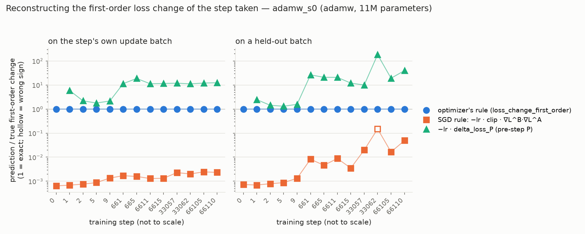

# Which update rule reconstructs the step an AdamW run took?

A small check on one training run, produced by
`examples/adamw_vs_sgd_reconstruction/run.py` (compute) and
`examples/adamw_vs_sgd_reconstruction/evaluate.py` (table and figure). It is
not a study: one run, one seed, an 11M-parameter model, thirteen steps, two
batches.

## The question

At a checkpoint of an AdamW run, the step that was taken changed the loss on a
batch `B`, to first order, by

```
truth = ∇L^B · (θ_{t+1} − θ_t)        from the two stored weight files
```

How well is that number reconstructed from what was known *before* the step?
Three candidates:

| candidate | what it is | row(s) |
|---|---|---|
| the optimizer's rule | the AdamW update rebuilt from the saved optimizer state: gradient part + momentum-history part + weight-decay part | `loss_change_first_order` |
| the SGD rule | the same step as plain SGD would have taken it — no momentum, no weight decay, the same learning rate, on the gradient the optimizer was handed (i.e. after the run's clipping): `−η · c · ∇L^B · ∇L^A` | `−update_lr · update_clip_factor · delta_loss` |
| `−η · delta_loss_P` | the hypothetical update `−η P_t ∇L^A` with the pre-step AdamW preconditioner, without momentum and decay (for reference) | `−update_lr · delta_loss_P` |

"The SGD rule, unclipped" is the same without the factor `c`; it differs only at
the one step where the clip engaged. The realized loss change
`L_B(θ_{t+1}) − L_B(θ_t)` is shown next to them, so that what first order itself
misses is visible.

## What was run

- Bundle: an 11M-parameter Llama trained with AdamW (peak rate 2e-3, warm-up
  from 1e-5 over 100 steps, `β = (0.9, 0.95)`, weight decay 0.01), batch
  32 × 512 tokens, pad-masked loss, gradient norm clipped at 1.0, fp32 weight
  files. The bundle records the clipping value but not the algorithm, so it was
  stated: `--clip-grad-norm 1.0`.
- 50 of the bundle's 85 checkpoints have their successor stored (steps 0–9,
  661–670, 6611–6620, 33057–33066, 66105–66114). Used: **0, 1, 2, 5, 9, 661,
  665, 6611, 6615, 33057, 33062, 66105, 66110** — the first steps of the
  warm-up, and two steps from each later group.
- Batches: the step's own update batch, and one held-out batch of 8 × 512
  tokens scored with the run's pad convention.
- fp32, `micro_batch_size=8`, on one RTX 3090 Ti (11 s for the thirteen
  checkpoints in the run committed here; 13 s and 34 s in two other runs of the
  same command on the shared card, whose `loss_change*` rows agree with the
  committed ones to 3.1e-10 in absolute terms). The same thirteen steps on the CPU (115 s) give the same table: every
  `loss_change*` row agrees with the GPU value to within 1.1e-7 in absolute
  terms (2e-5 to 3e-4 relative on the first-order rows, more only where a value
  is itself below 1e-6), and the learning-rate and clip-factor rows to 3e-7.

```bash
python examples/adamw_vs_sgd_reconstruction/run.py --bundle <run>/bundle \
    --eval-batches <run>/eval_batches --clip-grad-norm 1.0 --device cuda \
    --steps 0 1 2 5 9 661 665 6611 6615 33057 33062 66105 66110
python examples/adamw_vs_sgd_reconstruction/evaluate.py
```

## What it shows



- **The AdamW rule reconstructs the first-order change at every step measured**,
  on both batches: the ratio to the truth is within 1.6e-5 of one at step 0
  (where the step is so small that fp32 rounding of the stored weights shows)
  and within 1e-5 of one at the other twelve steps; the largest absolute
  difference is 1.4e-7.
- **The SGD rule is too small by a factor of 400 to 1600 on the update batch**
  (ratio 0.0006 to 0.0025) and by 20 to 1400 on the held-out batch (0.0007 to
  0.05), and at one step (33062, held-out batch) it has the wrong sign. At no
  step measured does it reconstruct the step better than the AdamW rule. That
  it is far too small is expected and says little by itself: the learning rate
  of this run was set for preconditioned steps.
- **Early in training the SGD rule is wrong by nearly one factor; later it is
  not.** In the first ten steps the SGD rule's ratio on the held-out batch
  divided by its ratio on the update batch is 0.98 to 1.13 (second table): a
  plain-gradient step with a rescaled learning rate would have reconstructed
  both batches to within about 13%. From step 661 on that quotient is 2.7 to 21
  (and negative at step 33062), so no rescaling repairs it. In those first ten
  steps the SGD rule is, by this scale-free measure, *closer* to the step taken
  than `−η · delta_loss_P` is, whose quotient there is 0.41 to 0.74. From step
  661 on it is the other way round: the quotient of `−η · delta_loss_P` is 0.84
  to 3.2 (16 at step 33062) against the SGD rule's 2.7 to 21.
- **`−η · delta_loss_P` is 1.3 to 5.9 times the truth in the first ten steps
  and 10 to 40 times later** (182 times at step 33062 on the held-out batch,
  where the truth is small). It is a different quantity, not an estimate of the
  step taken; the factor of about ten late in training is mostly the weight
  `1 − β1 = 0.1` with which the current gradient enters an AdamW step.
- **First order itself**: during the warm-up the realized loss change differs
  from the truth by 0.01% to 0.11% (steps 0–5) and by 1% to 1.6% (step 9). At
  the full learning rate it differs by 13% on the update batch at steps 661 and
  665 and by 3% to 5% later. On the held-out batch the realized change then has
  the opposite sign to the first-order change at five of the eight later
  measurements (steps 661, 665, 6611, 33062, 66110): there, even an exact
  reconstruction of the first-order term does not predict the loss change of
  one step.

## What it does not show

- Nothing about SGD-*trained* runs: the SGD rule here is a counterfactual step
  from a point an AdamW run reached.
- Nothing beyond this run: one seed, one model size, one learning-rate
  schedule, thirteen of 66 116 steps, one held-out batch of 4 096 tokens. The
  factors above are not constants.
- Nothing about which optimizer trains better.
- The clip engaged at one of the thirteen steps (step 9, factor 0.837), so the
  difference between the SGD rule with and without the clip factor rests on a
  single measurement.

## The numbers

Bundle `adamw_s0` (adamw, rows tagged `adamw_update`), 10,981,440 parameters, clipping stated as `1.0`, fp32 on NVIDIA GeForce RTX 3090 Ti. Update batch [32, 512] tokens, held-out batch `eval_batch_2.npy` [8, 512] tokens. Steps [0, 1, 2, 5, 9, 661, 665, 6611, 6615, 33057, 33062, 66105, 66110] of the 50 that have their successor stored.

Predictions are `ratio to the truth (prediction − truth)`; the truth is `loss_change_first_order_weights`.

| step | batch | lr | clip factor | truth | optimizer's rule | SGD rule | SGD rule, unclipped | −lr · delta_loss_P | realized loss change | realized − truth |
|---|---|---|---|---|---|---|---|---|---|---|
| 0 | update_batch | 1e-05 | 1.000 | -1.0192e-02 | 1.0000140 (-1.42e-07) | 0.0006433 (+1.02e-02) | 0.0006433 (+1.02e-02) | — | -1.0194e-02 | -2.07e-06 |
| 0 | held_out | 1e-05 | 1.000 | -8.2311e-03 | 1.0000153 (-1.26e-07) | 0.0007283 (+8.23e-03) | 0.0007283 (+8.23e-03) | — | -8.2331e-03 | -2.03e-06 |
| 1 | update_batch | 2.99e-05 | 1.000 | -2.6263e-02 | 1.0000003 (-7.51e-09) | 0.0006887 (+2.62e-02) | 0.0006887 (+2.62e-02) | 5.941 (-1.30e-01) | -2.6279e-02 | -1.67e-05 |
| 1 | held_out | 2.99e-05 | 1.000 | -2.4097e-02 | 1.0000004 (-1.03e-08) | 0.0006982 (+2.41e-02) | 0.0006982 (+2.41e-02) | 2.458 (-3.51e-02) | -2.4112e-02 | -1.58e-05 |
| 2 | update_batch | 4.98e-05 | 1.000 | -4.4120e-02 | 1.0000002 (-6.96e-09) | 0.0007602 (+4.41e-02) | 0.0007602 (+4.41e-02) | 2.192 (-5.26e-02) | -4.4155e-02 | -3.50e-05 |
| 2 | held_out | 4.98e-05 | 1.000 | -4.1300e-02 | 1.0000002 (-7.43e-09) | 0.0007916 (+4.13e-02) | 0.0007916 (+4.13e-02) | 1.436 (-1.80e-02) | -4.1334e-02 | -3.46e-05 |
| 5 | update_batch | 0.00011 | 1.000 | -9.4536e-02 | 0.9999999 (+1.05e-08) | 0.0008788 (+9.45e-02) | 0.0008788 (+9.45e-02) | 1.782 (-7.39e-02) | -9.4545e-02 | -8.52e-06 |
| 5 | held_out | 0.00011 | 1.000 | -9.3533e-02 | 0.9999999 (+1.19e-08) | 0.0008768 (+9.35e-02) | 0.0008768 (+9.35e-02) | 1.31 (-2.90e-02) | -9.3434e-02 | +9.88e-05 |
| 9 | update_batch | 0.000189 | 0.837 | -1.6629e-01 | 1.0000002 (-3.58e-08) | 0.001359 (+1.66e-01) | 0.001625 (+1.66e-01) | 2.159 (-1.93e-01) | -1.6468e-01 | +1.61e-03 |
| 9 | held_out | 0.000189 | 0.837 | -1.6805e-01 | 1.0000002 (-3.82e-08) | 0.00133 (+1.68e-01) | 0.00159 (+1.68e-01) | 1.571 (-9.59e-02) | -1.6540e-01 | +2.65e-03 |
| 661 | update_batch | 0.002 | 1.000 | -1.3867e-01 | 0.9999999 (+8.87e-09) | 0.001702 (+1.38e-01) | 0.001702 (+1.38e-01) | 11.42 (-1.44e+00) | -1.2078e-01 | +1.79e-02 |
| 661 | held_out | 0.002 | 1.000 | -8.3395e-03 | 0.9999999 (+6.95e-10) | 0.008235 (+8.27e-03) | 0.008235 (+8.27e-03) | 26.34 (-2.11e-01) | +3.4611e-03 | +1.18e-02 |
| 665 | update_batch | 0.002 | 1.000 | -1.4640e-01 | 0.9999999 (+1.49e-08) | 0.001584 (+1.46e-01) | 0.001584 (+1.46e-01) | 18.66 (-2.59e+00) | -1.2678e-01 | +1.96e-02 |
| 665 | held_out | 0.002 | 1.000 | -8.0108e-03 | 0.9999988 (+9.69e-09) | 0.004604 (+7.97e-03) | 0.004604 (+7.97e-03) | 20.83 (-1.59e-01) | +4.5916e-03 | +1.26e-02 |
| 6611 | update_batch | 0.002 | 1.000 | -7.9424e-02 | 0.9999999 (+7.42e-09) | 0.001297 (+7.93e-02) | 0.001297 (+7.93e-02) | 11.26 (-8.15e-01) | -7.5816e-02 | +3.61e-03 |
| 6611 | held_out | 0.002 | 1.000 | -2.0897e-03 | 0.9999999 (+2.43e-10) | 0.008842 (+2.07e-03) | 0.008842 (+2.07e-03) | 20.78 (-4.13e-02) | +3.7295e-04 | +2.46e-03 |
| 6615 | update_batch | 0.002 | 1.000 | -8.3573e-02 | 0.9999999 (+4.40e-09) | 0.001326 (+8.35e-02) | 0.001326 (+8.35e-02) | 11.54 (-8.81e-01) | -7.9624e-02 | +3.95e-03 |
| 6615 | held_out | 0.002 | 1.000 | -5.6460e-03 | 1.0000012 (-6.64e-09) | 0.003517 (+5.63e-03) | 0.003517 (+5.63e-03) | 11.98 (-6.20e-02) | -3.1580e-03 | +2.49e-03 |
| 33057 | update_batch | 0.002 | 1.000 | -6.2710e-02 | 1.0000000 (+1.47e-09) | 0.002283 (+6.26e-02) | 0.002283 (+6.26e-02) | 11.89 (-6.83e-01) | -6.0392e-02 | +2.32e-03 |
| 33057 | held_out | 0.002 | 1.000 | -2.3079e-03 | 0.9999980 (+4.67e-09) | 0.01981 (+2.26e-03) | 0.01981 (+2.26e-03) | 9.949 (-2.07e-02) | -1.0566e-03 | +1.25e-03 |
| 33062 | update_batch | 0.002 | 1.000 | -6.6061e-02 | 1.0000000 (-5.43e-10) | 0.002014 (+6.59e-02) | 0.002014 (+6.59e-02) | 11.14 (-6.70e-01) | -6.3324e-02 | +2.74e-03 |
| 33062 | held_out | 0.002 | 1.000 | -1.2779e-04 | 0.9999910 (+1.15e-09) | -0.1499 (+1.47e-04) | -0.1499 (+1.47e-04) | 182.2 (-2.32e-02) | +9.6699e-04 | +1.09e-03 |
| 66105 | update_batch | 0.002 | 1.000 | -5.9246e-02 | 0.9999999 (+4.58e-09) | 0.002459 (+5.91e-02) | 0.002459 (+5.91e-02) | 12.04 (-6.54e-01) | -5.7270e-02 | +1.98e-03 |
| 66105 | held_out | 0.002 | 1.000 | -2.0014e-03 | 0.9999967 (+6.61e-09) | 0.01647 (+1.97e-03) | 0.01647 (+1.97e-03) | 19.08 (-3.62e-02) | -8.6256e-04 | +1.14e-03 |
| 66110 | update_batch | 0.002 | 1.000 | -5.4117e-02 | 0.9999999 (+3.66e-09) | 0.002329 (+5.40e-02) | 0.002329 (+5.40e-02) | 12.42 (-6.18e-01) | -5.2185e-02 | +1.93e-03 |
| 66110 | held_out | 0.002 | 1.000 | -5.2330e-04 | 1.0000066 (-3.46e-09) | 0.04917 (+4.98e-04) | 0.04917 (+4.98e-04) | 39.54 (-2.02e-02) | +4.4486e-04 | +9.68e-04 |

Ratio on the held-out batch divided by the ratio on the update batch (1 = off by the same factor on both, i.e. repairable by rescaling the step):

| step | optimizer's rule | SGD rule | −lr · delta_loss_P |
|---|---|---|---|
| 0 | 1 | 1.132 | — |
| 1 | 1 | 1.014 | 0.4137 |
| 2 | 1 | 1.041 | 0.6551 |
| 5 | 1 | 0.9977 | 0.7353 |
| 9 | 1 | 0.9785 | 0.7275 |
| 661 | 1 | 4.838 | 2.307 |
| 665 | 1 | 2.907 | 1.116 |
| 6611 | 1 | 6.815 | 1.846 |
| 6615 | 1 | 2.652 | 1.038 |
| 33057 | 1 | 8.678 | 0.8366 |
| 33062 | 1 | -74.42 | 16.35 |
| 66105 | 1 | 6.696 | 1.585 |
| 66110 | 1 | 21.12 | 3.184 |
