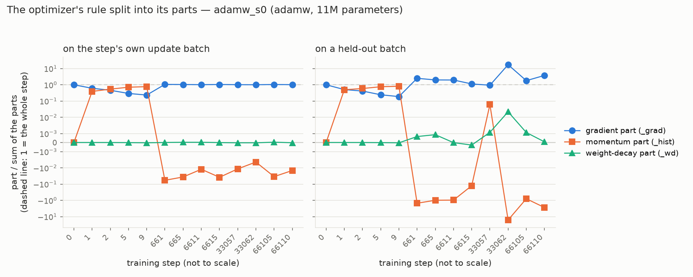

# Which update rule reproduces the step an AdamW run took?

An AdamW run took a step from θ_t to θ_{t+1}. How much that step changed the
loss on a batch, to first order, can be read off the two stored weight files;
call it the truth. Which rule, using only what was known before the step,
predicts it?

1. the AdamW update that vatis rebuilds from the saved optimizer state;
2. a plain SGD step with the same learning rate η (and the same gradient
   clipping);
3. AdamW's preconditioner P — its per-parameter step-size factors before the
   step — applied to the current gradient alone (−η·δL_P, where δL_P is the
   dot product of the batch's gradient with the step's gradient, weighted by
   P).

Rule 1 has to match: that it does checks vatis and the bundle, it is not a
finding. The point is how far off rules 2 and 3 are. Each is evaluated on the
step's own batch and on one held-out batch. One run, one seed, 11M parameters,
13 steps, 2 batches; row names and formulas are in [details.md](details.md).

## What you need

- **A checkpoint bundle that is not part of this repository**: an AdamW run
  with fp32 weight files, in which every step used has its successor stored
  (the truth needs θ_t and θ_{t+1}), plus a directory of held-out
  `eval_batch_*.npy` files (the last one is used).
- The model code: `run.py` rebuilds the Llama from the training repository's
  model definition (point the environment variable `VATIS_LLAMA_MODEL_PATH` at
  that repository), or from your own factory given as
  `--model-factory module:function`.
- The gradient clipping of the run. This bundle records the clip value but not
  the algorithm, so the command states it: `--clip-grad-norm 1.0`.
- A GPU is optional: 11 s on an RTX 3090 Ti for the 13 steps committed here,
  115 s on the CPU.

## How to run

```bash
python examples/adamw_vs_sgd_reconstruction/run.py --bundle <run>/bundle \
    --eval-batches <run>/eval_batches --clip-grad-norm 1.0 --device cuda \
    --steps 0 1 2 5 9 661 665 6611 6615 33057 33062 66105 66110
python examples/adamw_vs_sgd_reconstruction/evaluate.py   # tables + reconstruction.png + update_parts.png
```

## What it shows


*Ratio of each prediction to the truth, log scale; the horizontal line at 1
means exact. Hollow markers have the wrong sign and are drawn at |ratio|. Steps
are not to scale. Steps 0–9 are in the learning-rate warm-up, and the clip
engaged only at step 9 (c = 0.837). The figure calls rule 1 the
optimizer's rule.*

1. **The AdamW rule reproduces the truth.** It agrees to within 2·10⁻⁵
   relative at every step. This is the consistency check.
2. **After the warm-up no learning rate fixes the SGD rule.** It is
   400–1600× too small, as expected, since the rate was set for AdamW. The real
   test is whether one rescaling fits both batches at once. In the first ten
   steps it nearly would (within 13%), but there the two batches' gradients are
   strongly aligned, so that proves little. From step 661 on the two batches
   would need factors 2.7–21 apart, and at step 33062 factors of opposite
   sign.
3. **−η·δL_P overshoots the step taken, by ten times or more late in
   training** (10–40 times the truth from step 661 on, and 182 times at step
   33062 on the held-out batch, where the truth is small). The current gradient
   enters an AdamW
   step only with weight 1 − β₁ = 0.1, and the step is taken with a
   preconditioner already updated by that same gradient. That is how AdamW
   works, not something read from the result file.
4. **First order is not the whole step.** From step 661 on, the realized loss
   change on the held-out batch (`L(θ_{t+1}) − L(θ_t)`) has the opposite sign
   to the first-order change at 5 of 8 steps.

All ranges, per-step numbers and the reasoning behind points 2 and 3 are in
[details.md](details.md).



*The parts of the AdamW rule (rows `loss_change_first_order_grad`, `_hist`,
`_wd`) as fractions of their sum; symmetric-log axis, linear between ±10⁻³.*
After the warm-up the step on the update batch is almost entirely its gradient
part (1.00–1.06 of the sum from step 661 on). On the held-out batch the
momentum part has the opposite sign at 7 of the 8 steps from 661 on and is
often comparable in size to the gradient part (at step 33062: 17.2 and
−16.2). The weight-decay part is below 0.2% of the sum everywhere except at step 33062 on
the held-out batch, where it is 2%.

The numbers per step and batch: [table.md](table.md) — the ratios of the
figure above, the learning rate and clip factor c of each step (the SGD rule
without the clip factor is its ratio divided by c), the ratio on the held-out
batch divided by the ratio on the update batch, and the parts as fractions.
The same with more digits and the differences from the truth:
[table_full.md](table_full.md).

## What it does not show

- Nothing about SGD-*trained* runs: the SGD rule here is a counterfactual step
  from a point an AdamW run reached.
- Nothing beyond this run: one seed, one model size, one learning-rate
  schedule, 13 of 66 116 steps, one held-out batch of 8 × 512 tokens. The
  factors above are not constants.
- Nothing about which optimizer trains better.
- The clip engaged at one step only, so how the SGD rule would look without the
  factor c rests on a single measurement.

## About the committed outputs

- Files: `results.parquet`, `run_summary.json`, `table.md`, `reconstruction.png`,
  `update_parts.png`, `table_full.md` (the wide table: 4–7 digits, differences,
  the unclipped SGD rule). All but the first two are drawn by `evaluate.py`
  from the first two.
- The run: bundle `adamw_s0`, an 11M-parameter Llama trained with AdamW;
  details of the run and of the 13 steps used are in
  [details.md](details.md#the-run).
- Settings (from `run_summary.json` and `run.py`): fp32, `micro_batch_size=8`,
  `n_hutchinson=1` (`chi_net` is not used here), seed 0, `--device cuda` on an
  NVIDIA GeForce RTX 3090 Ti, torch 2.10.0+cu128; 11 s wall time. Repeated
  runs on the GPU and a run on the CPU give the same table
  ([details.md](details.md#reproducibility)).
- Committed on 17 November 2026 in `2d6b92f` (#14). `table.md` was made
  narrower and `update_parts.png` added later, both drawn from the same
  committed `results.parquet`; the earlier wide `table.md` is kept, unchanged,
  as `table_full.md`.
