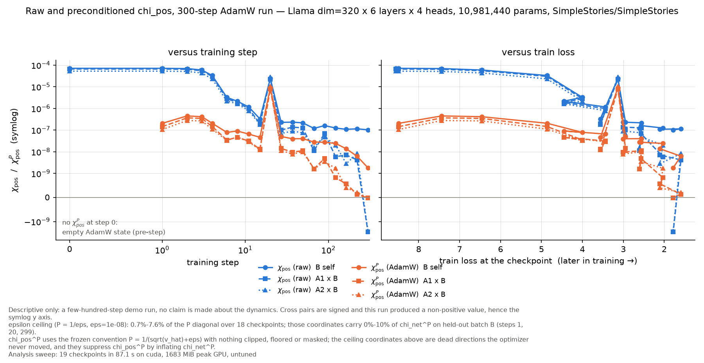

# What do `chi_pos` and its AdamW-preconditioned version look like over a training run?

A small Llama (10,981,440 parameters) is trained for 300 AdamW steps and saves
19 checkpoints, each with its optimizer state, as a checkpoint bundle. vatis
reads the bundle and measures, at every checkpoint and on one GPU, the raw
observables and the preconditioned observables (optimizer-aware measurement:
the same quantities on the kernel `J P Jᵀ`, with AdamW's `P = 1/(√v̂ + ε)` read
from the saved optimizer state). The result is one figure and a timing table.
The figure is descriptive: it shows that the pipeline works on a real bundle,
not how training behaves. Longer notes — the measurement batches, the padding
convention, the full sizing, the step-0 gap, the `1/ε` ceiling and the re-run
of the training — are in [details.md](details.md).

## What you need

- **A checkpoint bundle and its held-out batches, which are not part of this
  repository.** They are written by the training repository's
  `runs/example_bundle_run.sh`, in that repository's own environment (torch 2.9,
  lightning, perspic). The two environments never share a process; the bundle
  on disk is the hand-over.
- The training repository's model code, which `run.py` imports to rebuild the
  Llama (point the environment variable `WP0_LLAMA_SRC` at that repository).
- A GPU. Without one the script falls back to the CPU with a printed note and
  runs slowly.
- About 100 s on an RTX 3090 Ti for the committed run (87 s of it the sweep).

## How to run

```bash
# in the training repository, with its own environment:
bash runs/example_bundle_run.sh 300 32
#   -> $WP0_EXAMPLE_ROOT/bundle          the checkpoint bundle
#   -> $WP0_EXAMPLE_ROOT/eval_batches    3 held-out measurement batches (.npy)

# in vatis, separate process:
python examples/optimizer_aware_llama/run.py \
    --bundle "$WP0_EXAMPLE_ROOT/bundle" \
    --eval-batches "$WP0_EXAMPLE_ROOT/eval_batches" --device cuda
python examples/optimizer_aware_llama/evaluate.py --dir examples/optimizer_aware_llama
```

If the `eval_batch_*.npy` files are missing, `run.py` measures on random tokens
with a loud warning and marks the figure and `run_summary.json` "scientifically
empty": a pipeline demo, never a measurement.

## What it shows



Left: `chi_pos` (blue) and `chi_pos^P` (orange) versus training step; right:
the same versus train loss, with time running left to right. One line each for
the eval batch `B` on itself and for the two cross pairs `A1 × B` and `A2 × B`.
The y axis is symlog because cross pairs are signed.

- **There is no `chi_pos^P` at step 0.** The optimizer state of a step-0
  checkpoint is empty, so no AdamW `P` exists there; the P rows are skipped
  (18 of 19 checkpoints have them) and the orange curves start at step 1.
- **The `1/ε` ceiling matters early and fades.** Coordinates the optimizer has
  never touched sit at `P = 1/ε = 1e8`. On batch `B` they carry 10.23% of
  `chi_net^P` at step 1, 0.37% at step 20 and 0.00% at step 299; they are 7.61%,
  1.73% and 0.71% of all coordinates. All of them are rows of the token
  embedding.
- **The cross pairs turn negative at the last checkpoint:** at step 299 both
  `chi_pos` and `chi_pos^P` are slightly negative for `A1 × B` and `A2 × B`.
- **The preconditioned observables cost nothing extra:** about 4 s of analysis
  per checkpoint for 3 batches and 2 cross pairs, both observables together,
  because the P values reuse the raw pass's probes. Peak GPU memory 1683 MiB.

## What it does not show

- Anything about training dynamics at scale. A 300-step run of an 11M-parameter
  model shows that the pipeline produces these curves and what they look like;
  no claim is made beyond that.
- Anything about padding masking: this run's training loss masks no padding, so
  every position is counted ([details.md](details.md#what-it-measures-on)).
- Timings for an idle card: the card is shared, and nothing watched it during
  the run (it was idle just before and after). The timings are as measured, not
  tuned.
- The training run behind the earlier (July 2026) outputs: that bundle was
  lost, and the committed files come from a re-run of the same training, which
  drifts from the first one after step 27
  ([details.md](details.md#outputs-and-the-re-run-of-the-training)).

## About the committed outputs

- Files: `results.parquet` (1020 rows), `run_summary.json` (settings,
  per-checkpoint train loss and learning rate, the timing table, the `P = I`
  re-check, the ceiling records), `performance.csv` (the timing table),
  `chi_pos_raw_vs_adamw.png`.
- Settings: `chi_net_method="per_sequence_cv"`, `n_hutchinson=32`,
  `micro_batch_size=8`, fp32, seed 0, `--device cuda` (recorded in
  `run_summary.json`).
- Hardware: NVIDIA GeForce RTX 3090 Ti, torch 2.10.0+cu128 (recorded in
  `run_summary.json`).
- Regenerated on 17 November 2026 with the then-current code and committed in
  `e1aa6f4` (#15); moved into this folder, unchanged, in `e86142f`.
