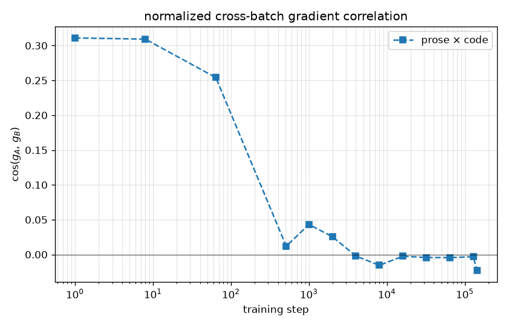

# How do prose and code gradients of Pythia-14m relate over training?

This is the example to start with. It loads `EleutherAI/pythia-14m` at 13
published training checkpoints, measures `chi_loss`, `chi_net`, `delta_loss`
and `chi_pos` on a prose batch and a code batch at each one, and adds the
cross pair (prose, code): does a gradient step on prose help or hurt the model
on code, and how does that change as Pythia trains? Longer notes — why real
text, how the run is sized, the early-phase findings in full — are in
[details.md](details.md).

## What you need

- vatis with the `examples` extra (matplotlib): `uv pip install ".[examples]"`.
- Internet access the first time: the 13 checkpoints are downloaded from the
  HuggingFace hub. Set `HF_HOME` (shell or the repo-root `.env`) to choose where
  they go.
- A GPU is used when one is present; otherwise the script runs on the CPU.
- About 76 s the first time and 52–55 s with the checkpoints cached, on an
  RTX 3090 Ti.

## How to run

```bash
.venv/bin/python examples/pythia_sweep/run.py       # compute → results.parquet + four plots
.venv/bin/python examples/pythia_sweep/evaluate.py  # analyze → cos_similarity.png + a printed table
```

`evaluate.py` reads only `results.parquet` and imports no vatis code.

## What it shows



The figure is `cos(g_prose, g_code) = δL(prose, code) / sqrt(δL(prose, prose) · δL(code, code))`:
the cross `delta_loss` with the size of the two gradients divided out.

- **Most of the decorrelation is over by step 512.** The cosine falls from
  +0.31 at step 1 to +0.012 at step 512 (about 26×). It rebounds a little at
  step 1000 and then stays near zero, slightly negative.
- **The raw cross `delta_loss` is not monotonic** ([delta_loss.png](delta_loss.png)):
  +3.25 at step 1, +0.95 at step 64, +2.62 at step 1000, below zero from about
  step 4000, −18 at step 143000. Its step-1000 rebound looks much larger than
  in the cosine, because the gradients themselves grow at the same time.
- **The first 64 steps are warm-up, not learning:** `chi_loss_normalized` stays
  at 1.0 through step 64 on both batches ([chi_loss.png](chi_loss.png)).
- **`chi_net_normalized` dips before it grows** ([chi_net.png](chi_net.png)):
  about 1e8 at step 1, about 3e7 at step 64, then rising to about 5e10 by
  step 143000, the same on prose and on code.

Without the four early checkpoints (steps 1, 8, 64, 512) these curves look
smooth and monotonic; see [details.md](details.md#revisions-and-early-phase-findings).

## What it does not show

- Anything beyond one small model: one size (14M parameters), one seed, two
  batches of 1024 tokens each.
- Why the curves look the way they do. The reading of the `chi_net` dip in
  [details.md](details.md) is a plausible interpretation, not something this
  example tests.
- Exact `chi_net` and `chi_pos` values: they are random-probe estimates, and a
  new probe draw moves them by about 1% (at most 13%) — see
  [About the committed outputs](#about-the-committed-outputs).

## About the committed outputs

- Files: `results.parquet` (234 rows), `chi_loss.png`, `chi_net.png`,
  `delta_loss.png`, `chi_pos.png`, `cos_similarity.png`.
- Settings: `chi_net_method="per_sequence_cv"`, `n_hutchinson=32`, batch
  8 × 128 tokens, `micro_batch_size=8`, seed 0 (as recorded in the parquet and
  in `run.py`).
- Regenerated on 17 November 2026 with the then-current code and committed in
  `e1aa6f4` (#15). The timings above are from an RTX 3090 Ti; the result file
  does not record the device.
- Against the April 2026 files they replaced, `chi_loss` and `delta_loss` agree
  to rounding; `chi_net` and `chi_pos` differ by about 1% (at most 13%),
  because the random probes are now drawn differently for the same seed. Every
  number quoted above holds for the committed files.
