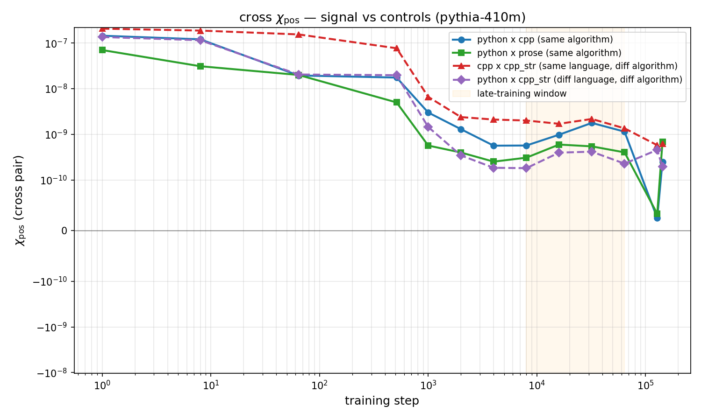

# Does `chi_pos` show a transient bump when training reaches what two texts share?

A research note with a negative result. The hypothesis: if two eval batches
share structure only in the "tail" of the NTK spectrum (deeper, later-learned
features), the cross `chi_pos(A, B)` — computed from the gradients of the
two batches — should be near zero early in training,
bump up when training reaches that spectral band, and subside afterwards. The
probes are Python and C++ code implementing the same matrix operations, with
English prose and an unrelated C++ program as controls, across five Pythia
sizes (14m–410m). The predicted bump does not appear. The hypothesis and the
probe design in full are in [details.md](details.md).

## What you need

- vatis with the `examples` extra (matplotlib).
- Internet access and disk space: the five models at 13 checkpoints each are
  about 34 GB of downloads. Set `HF_HOME` (shell or the repo-root `.env`) to
  choose where they go.
- A GPU is used when one is present; otherwise the script runs on the CPU.
  The result files record the analysis time of each measurement (column
  `wallclock_s`), not the download time or the time of a whole run.

## How to run

```bash
python examples/spectral_tail/run.py                                  # pythia-14m
python examples/spectral_tail/run.py --model EleutherAI/pythia-70m    # one other size
python examples/spectral_tail/run.py --all                            # all five sizes in turn
python examples/spectral_tail/evaluate.py                             # figures, x axis = training step
python examples/spectral_tail/evaluate.py --compute                   # x axis = estimated compute (6ND FLOPs)
```

## What it shows



Findings of 2026-04-16:

- **At 14m–410m scale the predicted spectral-tail bump is not observed.** All
  cross `chi_pos` trajectories decline after early training, apart from some
  scale-dependent late-training structure (secondary rises at 70m and 410m)
  that is not clearly separated from the controls.
- **The signal is above its control, but modestly.** In the late-training
  window the signal `python × cpp` (same algorithm) runs 2–4× above the
  cross-language control `python × cpp_str` (different algorithm) — not the
  transient bump the hypothesis predicts, but a hint of partial algorithm
  specificity. (The pair list in [details.md](details.md) calls
  `python × cpp_str` the secondary control; the negative control proper is
  `cpp × cpp_str`.)
- **The early decline is set by compute, not by scale.** Plotted over
  estimated compute (6ND FLOPs) instead of training steps, the initial
  `chi_pos` decline of all five sizes falls onto one curve (`evaluate.py
  --compute`, the `_compute` figures). This early phase reflects generic token-statistics learning.

The across-sizes view of the signal pair is
[figures/chi_pos_cross_scale_python_x_cpp.png](figures/chi_pos_cross_scale_python_x_cpp.png);
all figures are in [figures/](figures/).

## What it does not show

- Whether the model size or the method is the reason. The most likely
  explanation is that models at this scale do not build cross-language
  representations of "matrix multiplication"; the feature probed for may need
  larger models.
- Anything above 410m, or for a simpler shared feature. Two follow-ups:
  1. **Larger models (1B+)**, where cross-language code understanding may
     emerge and build the shared representations probed for here.
  2. **A simpler semantic overlap** that models of this size plausibly learn —
     repeated structural patterns, the same topic in different registers — to
     test whether the method works at all before scaling up.

  Doing (2) first is the more cautious path: if a simpler feature does not
  produce a bump even at 410m, the method itself needs rethinking, not just the
  scale.

## About the committed outputs

- Files: `results_pythia-{14m,31m,70m,160m,410m}.parquet` and `figures/`
  (step-based and `_compute` variants of every plot). The probe texts are in
  `probe_texts.py`, moved out of `run.py` unchanged.
- Settings: B = 1, S = 1024, `n_hutchinson=32`, 13 checkpoints per model
  (steps 1 to 143000), seed 0 (in `run.py`). `run.py` uses `per_sequence_cv`
  up to 160m and `hutchinson` for 410m. The hardware is not recorded.
- From April 2026, committed in `13b6f97` (16 April 2026), and not re-run since
  (that would mean downloading about 34 GB of checkpoints). The parquet files
  have the original 11 result columns. With the current code, `chi_net` and
  `chi_pos` would be a different random probe draw for the same seed;
  `chi_loss` and `delta_loss` would not change.
